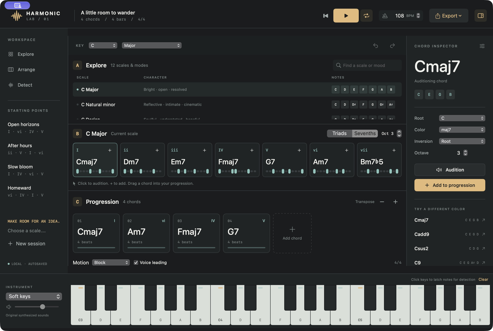

# Harmonic Lab

A native macOS harmony workstation inspired by Scaler 3's Explore / Detect → Current Scale → Progression workflow. Version 0.1.0, Apple Silicon, macOS 14 or newer.



Open **dist/Harmonic Lab.app**. Source and tests are included. The app uses SwiftUI, AVFoundation, CoreMIDI and Accelerate; there are no third-party package dependencies.

## What works

- All 12 roots and 12 scales/modes; diatonic triads and seventh chords for seven-note scales, and compatible chord choices for pentatonic/blues scales.
- 20 chord qualities including suspensions, sixths, sevenths, added ninths and ninths. Audition, inversion, octave and transposition controls.
- Progression clips: add/drag in, select, duplicate, delete, move left/right, change duration; undo/redo for editing actions.
- Original synthesized Soft keys, Warm pad and Glass pluck sounds. Looping playback at 40–240 BPM; Block, Strum and Arpeggio motion. Optional voice leading. Piano-roll visualization and keyboard highlights.
- Latching piano keys, typed note names/MIDI numbers and live CoreMIDI input for pitch-class chord detection. Matching scales and chord alternatives.
- Virtual **Harmonic Lab Out** MIDI source for a DAW. Export standard MIDI and mono PCM WAV; import polyphonic MIDI chord groups.
- Approximate audio-file chord analysis, with candidate review before using the progression.
- JSON `.harmonic` sessions, native save/open dialogs, automatic recovery of the last project and session file association.

## A quick session

1. Choose a root and scale in Explore. Click a chord to hear it, then use **+** or drag it into the progression.
2. Select a progression clip and change its color, inversion, octave or length in the inspector. Use its arrow, duplicate and trash controls for editing.
3. Pick a motion, enable voice leading if desired, and press **Space** to play. **Escape** stops all notes.
4. Choose **Export → Export MIDI** to bring the harmonic sketch into a DAW, or export WAV for an audio reference.
5. In Detect, enter `C4 E4 G4` or `60 64 67`, click Detect and review the candidates. You can also click piano keys to latch a chord.

For a MIDI keyboard: connect it before pressing **Connect MIDI**. Toggle the connection off/on to refresh devices. For DAW output, enable **MIDI OUT** and select **Harmonic Lab Out** as the DAW track's MIDI input. Physical hardware/DAW routing has not yet been tested; local virtual MIDI input and output have been tested.

Shortcuts: `⌘N` new, `⌘O` open, `⌘S` save, `⌘Z` undo, `⇧⌘Z` redo, `⌘E` MIDI export, `⇧⌘E` WAV export, `⇧⌘I` analyze audio, Space play/stop, `⌘L` loop, Escape panic.

## Current boundaries

This is an independently implemented first version, not full Scaler feature parity. It does not include Scaler's preset/sample library, commercial instrument sounds, guitar fretboard, multi-track arranger, full Motion library, Humanize, Keys Lock or Voice Grouping, AU/VST3 hosting, DAW sync, plugin packaging or live microphone analysis.

- Audio detection uses an original FFT/chroma approximation over the first 60 seconds. It works best on clear sustained instruments. Rhythm, gaps, key and bass can be ambiguous; review candidates by ear. In the test demo, voice-led Am7 was labeled C6, which has the same pitch classes. Quality on real mixed recordings is unverified.
- Audio analysis accepts decoded PCM at 8–192 kHz with up to 8 channels. WAV export is 22.05 kHz, mono, 16-bit PCM. Playback/WAV export is limited to three minutes; MIDI supports up to 128 clips with 0.5–16 beats each.
- MIDI import supports type 0/1 PPQ files, groups note-ons within 1/8 beat and excludes the drum channel. Leading rests, sustain pedal, tempo maps and other controller data are not retained. Imported timing is quantized to half beats. Audio candidate timing also removes gaps.
- Session saves include arrangement, tempo, key, scale, motion and voice leading. Instrument/volume, preview selections and UI preferences are not part of the project format.
- Local build is ad-hoc signed, not notarized. There are no accounts, API keys, network calls or downloaded musical assets.

## Build and test

```sh
cd HarmonicLab
swift test
zsh scripts/package.sh
```

Requires an installed Swift/Xcode toolchain. `scripts/make-icon.swift` contains the original icon artwork. `scripts/midi-probe.swift` is a local CoreMIDI integration probe.

Verification details and reference boundaries: **verification/report.md** and **SPEC.md**.
